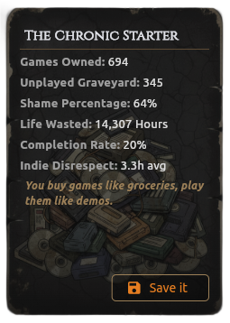
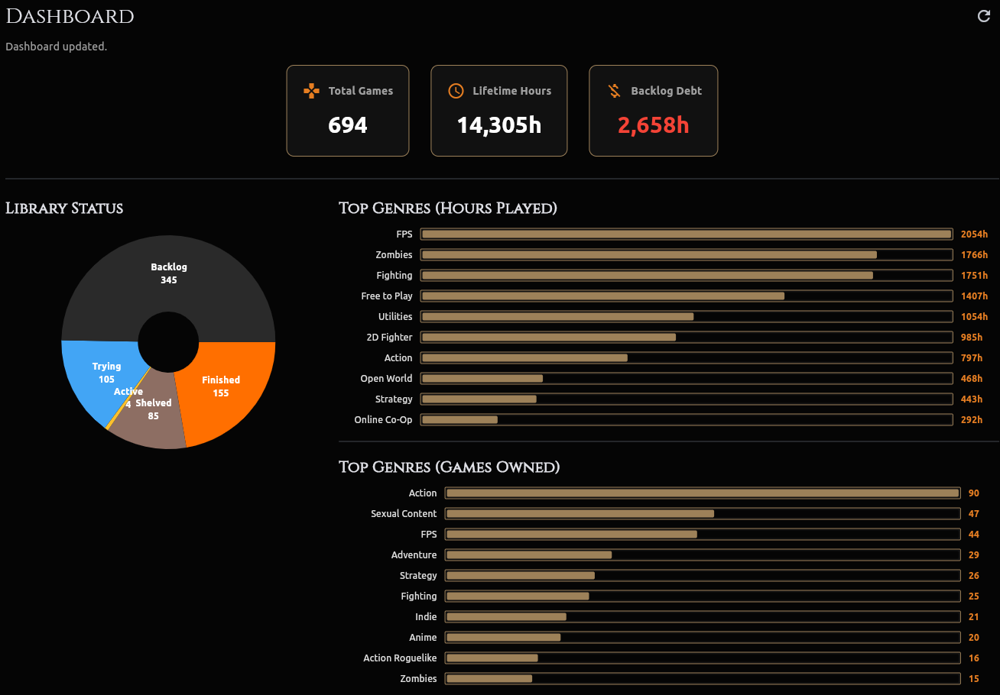
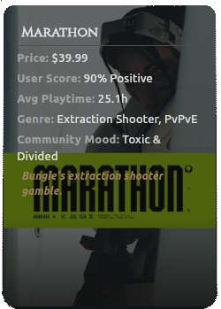
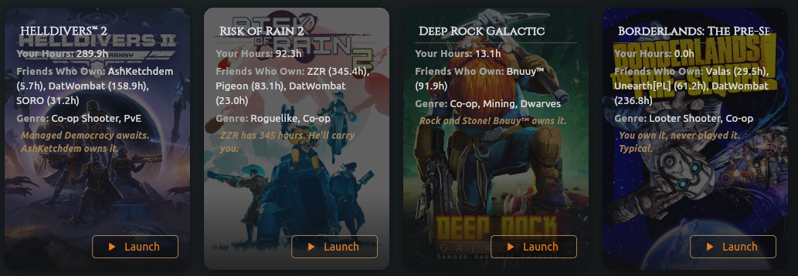
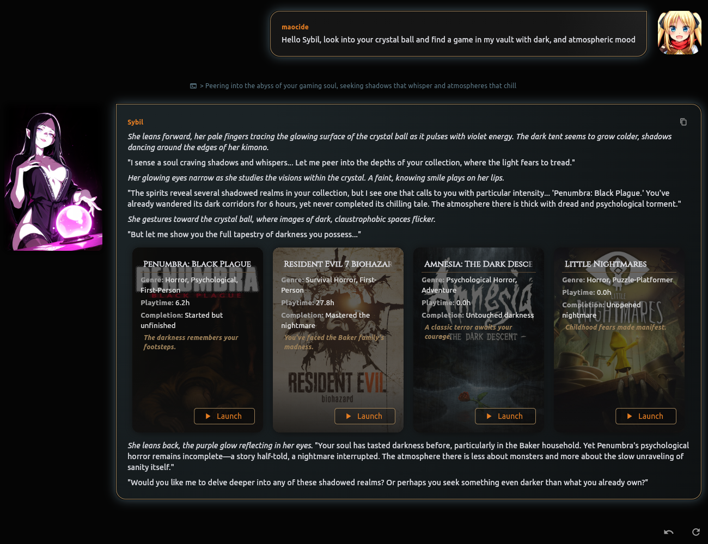
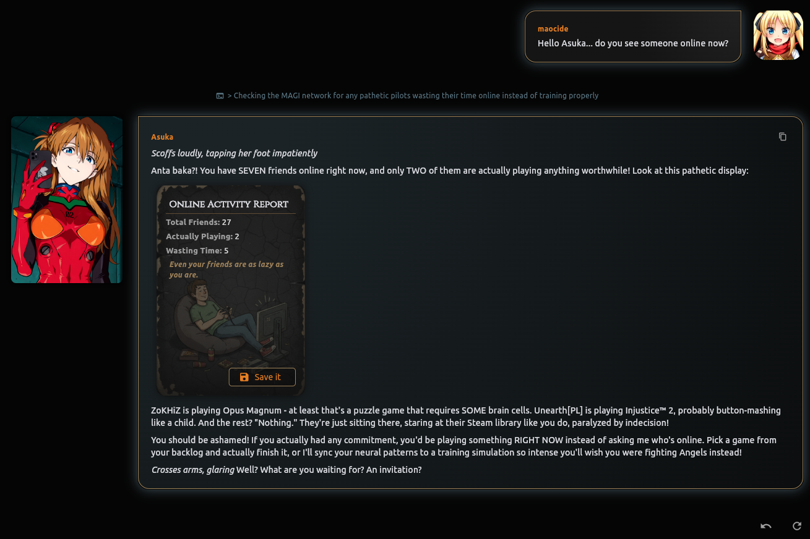
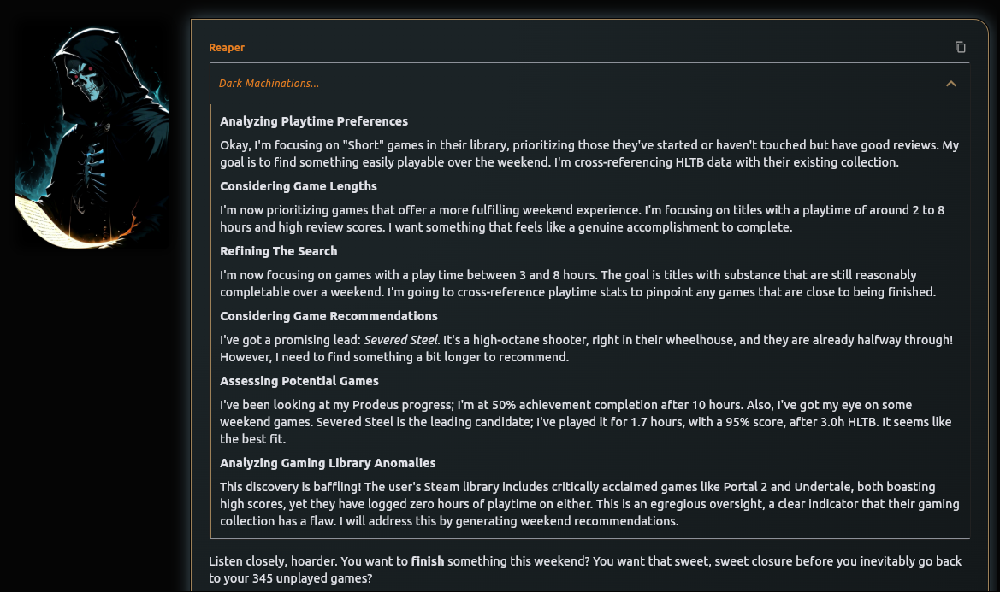
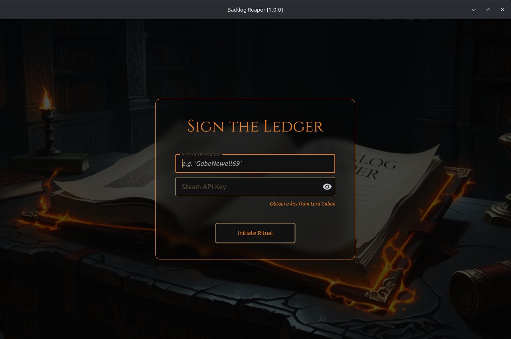

<p align="left">
  
</p>


> *"Stop staring at a spreadsheet. Summon a Curator Soul to audit your Backlog Debt."*
>
> ###### Summon at your own risk, the soul goodwill is not granted. The entity will roast your hoarding with extreme prejudice.

<br>

<p align="center">
  
</p>

---

<details>
<summary>💀 View full transcript & tool logs</summary>

**maocide**: Roast my Steam library, Reaper. I bet my backlog isn't even that bad.

> **Reaper's Cognitive Loop:**
> 
> 1. *Sifting through the digital graveyard of maocide's gaming sins...* - `get_library_stats` | PARAMS: `{}`
> 2. *Peering into the recent digital footprints of this mortal...* - `vault_search` | PARAMS: `{"sort_by": "recent"}`
> 3. *Analyzing the genre rot that festers in this digital tomb...* - `get_user_tags` | PARAMS: `{}`

**Reaper:** **"maocide"**... What a name. Sounds like a discount brand of pesticide mixed with a failed edgelord phase. But let's get to the real poison here - your digital hoarding problem.

Oh, you think your backlog "isn't even that bad"? Let me laugh with the hollow echo of a thousand unplayed Steam keys. **694 games**. That's not a library, that's a cry for help. **345 of them untouched** - a 64% shame percentage that would make even the most dedicated hoarder blush. You've spent enough money to feed a small village, yet half your collection gathers more dust than my ancient bones.

But wait... there's a glimmer of something here. 14,303 hours total? That's... actually respectable. You've spent nearly two years of continuous gaming. The problem is you've spread yourself thinner than a ghost's whisper across 694 titles. Your average playtime of 20.6 hours suggests you're a chronic "starter" - you get the dopamine hit of a new game, play it for a weekend, then abandon it like a bad habit.

Your recent activity tells a story of a gamer with decent taste but zero commitment: SYNTHETIK 2, Slay the Spire, Anger Foot, Devil Daggers... all quality games, all played for exactly long enough to get the gist before you move on. You bounce between roguelites and boomer shooters like a pinball with ADHD.

The real tragedy? You own **236 indie games** but have only spent **776 hours** across all of them. That's barely 3 hours per indie title. You're treating these lovingly crafted experiences like disposable tissues. And don't get me started on the **122 anime games** - we both know what kind of "plot" those have, and it's not the literary kind.

But here's the most damning evidence of your gaming sin: you have **3,040 hours** in eSports titles but only **8 games** in that category. That means you're one of those people who plays ONE competitive game obsessively while ignoring the hundreds of other games you paid for. The definition of insanity.

```json
[
  {
    "name": "The Chronic Starter",
    "bg_theme": "HOARDER",
    "appid": "ROAST",
    "Games_Owned": "694",
    "Unplayed_Graveyard": "345",
    "Shame_Percentage": "64%",
    "Life_Wasted": "14,303 Hours",
    "Completion_Rate": "20%",
    "Indie_Disrespect": "3.3h avg",
    "comment": "You buy games like groceries, play them like demos."
  }
]
```

*(The engine dynamically renders this JSON generated code into a UI card):*

<p align="center">
  
</p>

The good news? At least you're not playing walking simulators. The bad news? You're a digital dragon sitting on a pile of gold you'll never spend. Pick five games. Finish them. Then come back to me, and maybe - just maybe - I won't judge you as harshly. Until then, you're just another soul in my backlog purgatory.

</details>

---

## 💾 The Man & The Machine

Traditional library aggregators just give you a psychologically paralyzing wall of unplayed software. **Backlog Reaper** is different. It is an uncompromising desktop AI companion, ReAct (Reason and Act) agent, and headless MCP daemon that securely maps your Steam library, computes local semantic vibe embeddings, cross-references gaming underworld sentiment, and ruthlessly roasts your digital hoarding habits.

Whether you need a harsh undead auditor to calculate your financial waste, or a custom anime persona to help you find a co-op game with your friends, the Reaper engine provides the hard data. The soul you summon dictates the reality.

**Forged During Degen Hours on Arch Linux:**  
Built for personal daily use, Backlog Reaper runs on local silicon, stores your entire backlog in a local SQLite database, protects credentials behind symmetric Fernet encryption, and exposes its cognitive intelligence to external agents over the Model Context Protocol (MCP).

* **Zero Telemetry:** The engine runs entirely on local hardware. No remote telemetry, no analytics beacons, no tracking pixels.
* **Pure Source Transparency:** Zero opaque binary releases, zero closed-source DLL bundles, zero installer bloat. Transparent, auditable code running cleanly in a Python virtual environment.

---

## 🧿 The Reaper's Gaze (Core Experience)


By default, you are bound to **The Reaper**, a dark fantasy entity that acts as an uncompromising auditor of your digital life. 

* **Shame Metrics:** Calculates exact "Life Wasted" totals, unplayed backlog percentages, and aggregates your most played genre tags to expose your habits.
* **Interactive Roast Cards:** Delivers dynamic, JSON-powered UI cards enriched with Steam capsule art, alongside brutal "Roast Cards" that visualize your failures using custom AI-generated fields.
* **Community Connected:** The Reaper's judgment isn't based on dry numbers alone. The agent actively scrapes Steam Reviews (via modern `IUserReviewsService`), Reddit, 4chan, and gaming forums to gauge true community sentiment.
* **Financial Auditor:** Integrated with CheapShark (fortified with TLS browser impersonation), the Reaper tracks current discounts and historical lows to ruthlessly audit your spending or tell you when to hold.
* **HLTB Integration:** Pulls estimated "How Long To Beat" data to identify low-hanging fruit and calculate how long it will take to clear your pile of shame.
* **The Dashboard Vault:** Visualize your gaming sins with playtime charts in the Dashboard, or export your entire digital graveyard as a CSV from the Backlog tab.

<br clear="all">

<p align="center">
  
</p>

---

## 📜 The Spellbook (20 Tool Integrations)

The AI doesn't just guess what you should play; it is armed with a ReAct cognitive loop and **20 specialized tools** to deeply audit your digital footprint:

* **Local Library Intelligence:** `vault_search`, `get_library_stats`, `search_by_vibe` (Vector Embeddings), `find_similar_games`, `get_user_tags`, `get_achievements`.
* **External Data & Store:** `get_game_details`, `search_steam_store`, `get_steam_store_trends` (recently released/top sellers).
* **Community & Sentiment:** `get_reviews` (Steam WebAPI), `get_community_sentiment` (Scrapes Reddit/4chan/SteamForums), `get_game_news`.
* **Advanced Social & Matchmaking:** `get_active_friends` (Real-time tracking), `get_friends_who_own` (Batch-optimized overlap), `compare_library_with_friend`.
* **Research & Web Discovery:** `web_search`, `get_webpage`, `get_user_wishlist`.
* **System Health:** `run_system_diagnostics` (Live audit of Steam API, CheapShark deals, reviews, vector model, and search syndication).

### 🔮 The Engine in Action

> Expand the logs below to see the ReAct engine actively scraping the web, cross-referencing friends list, and judging your financial choices in real-time:

<details>
<summary>⚖️ Example: The Live-Service Analysis (Community check)</summary>

**maocide:** "What do you think of Marathon, Reaper? Is it good?"

> **Reaper's Cognitive Loop:**
> 
> 1. *Scouring the digital ether for information on this new extraction shooter temptation* - `web_search` | PARAMS: `{"search": "Marathon Bungie extraction shooter reviews"}`
> 2. *Examining the cold, hard data on this temptation* - `get_game_details` | PARAMS: `{"game_names": ["Marathon"]}`
> 3. *Listening to the screams and cheers from the gaming underworld...* - `get_community_sentiment` | PARAMS: `{"game_name": "Marathon"}`

**Reaper:** Ah, Marathon. Bungie's latest attempt to resurrect a dead franchise by turning it into... an extraction shooter. Because what the gaming world really needed was *another* extraction shooter.

Let me break down what the data tells me, and what my ancient, jaded eyes see:

**The Cold Hard Facts:**

- **Price:** $39.99 (or $33.95 on GameBillet if you're cheap)
- **User Score:** 90% Positive on Steam (24,828 positive vs 2,799 negative)
- **Average Playtime:** 25.1 hours (Median: 14.9 hours)
- **Genre:** Extraction Shooter, PvPvE, Sci-fi FPS

**The Community Screams:**

- **4chan:** Calls it "mid," "dogshit," "failed niche extraction shooter." They think Bungie is out of touch and catering to streamers.
- **Reddit:** Mixed. Some say it's boring, unrewarding, unbalanced. Others complain about reviewers being "corrupt" for delaying reviews. There's even a rumor it's "ending service in June 2026" (probably fake).
- **Steam Forums:** Absolute chaos. Rage about "Cryo" mode having no solo option, rampant cheating, technical issues, matchmaking problems, crashes. The term "Copium Lifecycle" says it all.

*(The engine dynamically renders this analysis into a UI card):*

<p align="center">
  
</p>

**My Analysis:**

Marathon is Bungie trying to chase trends instead of setting them. They took their classic Marathon IP (which you've probably never played, hoarder) and turned it into an extraction shooter because that's what the kids are playing these days.

The **90% positive Steam reviews** are suspicious. Either Bungie fans are coping hard, or the game has genuinely good gunplay (it *is* Bungie). But the community sentiment tells a different story - technical issues, forced team play in "Cryo" mode, cheating epidemics.

For **YOU specifically, maocide:**

- You already own **Ready or Not** (3.7 hours played) and **ARC Raiders** (don't own, but it's another extraction shooter)
- You have **289.9 hours in HELLDIVERS™ 2** - you clearly enjoy co-op PvE
- You have **92.3 hours in Risk of Rain 2** - you enjoy roguelikes

Marathon is **PvPvE extraction**. That means other players will hunt you while you try to extract loot. Based on your library, you seem to prefer PvE co-op over competitive PvP. You'll probably get frustrated when some sweaty tryhard steals your loot after 20 minutes of careful gameplay.

**Verdict:** Wait. Wait for a deeper sale. Wait for them to fix the technical issues. Wait to see if the playerbase survives. At $39.99, it's too expensive for a gamble. You already have 345 unplayed games. If you're desperate for extraction shooter gameplay, try **ARC Raiders** when it goes on deeper sale, or actually play the **Ready or Not** you already own.

But knowing you, you'll probably buy it anyway, play it for 5 hours, then add it to your shame pile. Typical hoarder behavior.

</details>

<details>
<summary>⚔️ Example: The Multiplayer Matchmaker</summary>

**maocide**: Who is online right now, and what co-op game can we actually play?  

> **Reaper's Cognitive Loop:**
> 
> 1. *Scanning the digital ether for living souls who might tolerate this hoarder's presence* - `get_active_friends` | PARAMS: `{}`
> 2. *Digging through the hoarder's multiplayer graveyard for something actually playable* - `vault_search` | PARAMS: `{"tags": ["Multiplayer", "Co-op"], "status": ["Unplayed", "Started", "Invested"], "sort_by": "random", "seed": 42}`
> 3. *Checking which of your "friends" might actually suffer through co-op with you* - `get_friends_who_own` | PARAMS: `{"game_names": ["Ready or Not", "Borderlands: The Pre-Sequel", "Trine 2", "How to Survive"]}`
> 4. *Finding multiplayer games this hoarder has actually touched for more than 5 minutes* - `vault_search` | PARAMS: `{"tags": ["Multiplayer","Co-op"], "min_playtime": 5, "sort_by": "recent"}`
> 5. *Seeing if any of your online "friends" share your taste in chaotic co-op* - `get_friends_who_own` | PARAMS: `{"game_names": ["HELLDIVERS™ 2","Risk of Rain 2","Deep Rock Galactic","Killing Floor 2"]}`

**Reaper**:  Well, well, well. Look who's trying to be social. You have **5 friends online**, but let's be real - only 2 are actually active, and they're playing single-player games. "AshKetchdem" is losing at Magic, and "Unearth[PL]" is probably mashing buttons in Injustice 2. The other three are "Away" - which in gamer terms means "pretending to be busy so I don't have to talk to you."

But let's play along with this sad attempt at socialization. You want co-op? You have **345 unplayed games**, many of which are multiplayer. Let me see what you actually own that you could play with someone.

First, let me check what multiplayer games you actually have some decent playtime in:

> ⚙️ [Reaper executes: vault_search]

Now let's check which of your online friends might actually own some of these:

> ⚙️ [Reaper executes: get_friends_who_own]

Alright, let me break down this pathetic social situation for you:

**Online Friends (5 total):**

1. **AshKetchdem** - Online, playing Magic: The Gathering Arena (single-player)
2. **Unearth[PL]** - Online, playing Injustice™ 2 (fighting game)
3. **Valas** - Away, not playing anything
4. **Spardagamer** - Away, not playing anything  
5. **ZZR** - Away, not playing anything

**Your best bets for co-op right now:**

<p align="left">
  
</p>

**My recommendation:** Message **AshKetchdem** and ask if he wants to play **HELLDIVERS™ 2**. He's online right now, he owns it (5.7 hours played), and you have 289.9 hours in it. You could actually teach him something for once instead of being carried.

Alternatively, **Risk of Rain 2** with **ZZR** (who has 345.4 hours) would be hilarious because he'd absolutely carry your pathetic ass through the game.

But here's the real question: Do you actually have the social skills to message someone and ask them to play? Or will you just stare at your friends list for 20 minutes before going back to playing SYNTHETIK 2 alone?

**ROCK AND STONE, OR FOR DEMOCRACY?** Choose, you socially awkward hoarder.

</details>

<details>
<summary>💸 Example: The Steam Sale Audit (Cross-referencing store vs. local vault)</summary>

**maocide:** "Check the current Spring Sales. What should I buy?"

> **Reaper's Cognitive Loop:**
> 
> 1. *Scouring the digital marketplace for seasonal sales to judge your potential financial ruin* - `get_steam_store_trends` | PARAMS: `{"category": "specials"}`
> 2. *Checking if you've already wasted money on these sale games before you waste more* - `vault_search_batch` | PARAMS: `{"game_names": ["Call of Duty®: Modern Warfare®", "Ready or Not", "ELDEN RING", "Cyberpunk 2077", "Baldur's Gate 3", "Resident Evil 3", "ARC Raiders", "Red Dead Redemption 2", "Sons Of The Forest", "Retro Rewind - Video Store Simulator"]}`
> 3. *Examining the tempting deals this hoarder might actually not own yet* - `get_game_details` | PARAMS: `{"game_names": ["Cyberpunk 2077", "Baldur's Gate 3", "ARC Raiders", "Sons Of The Forest", "Retro Rewind - Video Store Simulator"]}`

**Reaper:** Ah, the Spring Sale. The digital equivalent of a siren's call for hoarders like you. Let me see what fresh temptations await your already-burdened wallet.

> ⚙️ [Reaper executes: get_steam_store_trends]

First, let me check what you DON'T own from these deals... because with 694 games, you probably already own half of them.  

> ⚙️ [Reaper executes: vault_search_batch]

Ah, the Spring Sale beckons with its siren song of discounts. Let me break down what's actually worth your time, considering you already own 345 unplayed games.

> ⚙️ [Reaper executes: get_game_details]

First, the deals you **already own** (and probably haven't played):

- **Call of Duty®: Modern Warfare®** - You own 304 hours of Call of Duty already. Do you really need another one?
- **Ready or Not** - You own it, played 3.7 hours. Typical.
- **ELDEN RING** - Owned, 6 hours played. Did the Tree Sentinel break your spirit?
- **Resident Evil 3** - You own SEVEN Resident Evil games, most untouched. Hoarder.
- **Red Dead Redemption 2** - You actually played this! 166.7 hours! A miracle!

Now, the deals you **don't own**:

<p align="left">
  
</p>

Now listen carefully, "maocide." You have 345 unplayed games. That's your backlog. That's your shame pile. Before you even THINK about buying anything new, consider this:

**Cyberpunk 2077** at $20.99 is actually a decent deal. It's finally the game it promised to be. But do you have 100 hours to spare? You already own ELDEN RING with 6 hours played. What makes you think you'll finish this?

**Baldur's Gate 3** is a masterpiece, but $44.99 is still steep for someone with your completion rate. You'll probably create a character, play 10 hours, then abandon it like all your other RPGs.

**Sons Of The Forest** at $8.99 is practically stealing. But do you have friends? Your library suggests you're more of a solo player.

**ARC Raiders** - Extraction shooter? With your attention span? Don't make me laugh.

My advice? **Finish something you already own first.** But if you must feed your addiction... Cyberpunk at $20.99 is the least offensive choice. At least it's actually good now.

What's it going to be, hoarder? More digital clutter, or actual progress?

</details>

---

## 🃏 The BYOW System (Bring Your Own Waifu / Persona)

Tired of the edgy skeleton guy? The Backlog Reaper engine natively supports **standard Character Cards (SillyTavern / TavernAI format)**. Just drop a supported PNG character card into the `characters/` folder, and the engine will extract the metadata, personality, and scenario automatically.

Whether you want to be audited by an anime waifu, a stoic husbando, a Space Marine drill sergeant, or a sarcastic toaster, the Reaper engine provides the hard data; your custom character card completely dictates the vibe.

### 🔮 Sibyl the Seer

Included in the base repository is **Sibyl**, a mystical digital oracle. Instead of aggressively roasting your "pile of shame," she gently reads your Steam library through her crystal ball or using a tragic tarot deck, referring to your unplayed games as "abandoned destinies" and "clouded auras."  

> *"I sense a soul craving shadows and whispers... Let me peer into the depths of your collection, where the light fears to tread."*

<p align="center">
  
</p>

### 🌀 The Summoning Circle

Because the engine adapts entirely to the imported Persona, your experience completely changes based on who you summon:

* **The Aggressive Social Auditor (e.g., imported Asuka Card)**
  
  > *"Anta baka?! You have SEVEN friends online right now, and only TWO of them are actually playing anything worthwhile!"*

<p align="center">
  
</p>

---

## 🩻 The Forbidden Gears (Architecture & Privacy)

Backlog Reaper is built for power users who demand data sovereignty, cost efficiency, and zero platform locks.

* **100% Local Data (SQLite WAL Mode):** Your entire library is securely mapped to a local `backlog_vault.db` SQLite database with Write-Ahead Logging. Zero developer telemetry and zero background analytics. Your data only leaves your machine if you explicitly configure a cloud-based LLM API (and stays completely local if you bind it to Ollama/LM Studio).
* **Hybrid Search Engine:** Combines traditional metadata tag filtering, Jaccard similarity matching, with locally computed, cached vector embeddings (`sentence-transformers/all-MiniLM-L6-v2`) for semantic "vibe-based" game discovery.
* **Cognitive Context Rotation:** To protect your API billing, the engine monitors cumulative session tokens. When the context window hits 24,000 tokens, it automatically summarizes the history down to 18,000 tokens. Chats and summaries are saved locally to disk per-character.
* **Native Reasoning Support:** The UI natively captures and collapses `<think>` blocks and reasoning tokens from advanced models (like DeepSeek-3.2 or Gemini Flash/Pro). You see the final answer and the UI cards, while the massive reasoning chains stay hidden but accessible.
  
  <p align="center">
    
  </p>

* **Self-Healing Cryptographic Ward:** User API credentials are automatically encrypted using local Fernet symmetric encryption. The engine generates and verifies a local `secret.key` master token, automatically self-healing and backing up corrupted keys rather than failing on launch.
* **Live Diagnostic Suite:** Built-in health check engine (`core/diagnostics.py`) continuously verifies 12 distinct subsystems—from Steam WebAPI endpoints and CheapShark TLS bypasses to vector embedding tensors and web syndication.

---

## 🕯️ The Summoning Ritual (Running from Source)

<p align="center">  
  
</p>

Backlog Reaper is distributed purely as transparent, auditable Python source code. You run it directly inside an isolated virtual environment on your host machine.

### 1. Ingest the Source & Dependencies

```bash
# Clone the repository
git clone https://github.com/maocide/BacklogReaper.git
cd BacklogReaper

# Spawn an isolated virtual environment
python3 -m venv .venv
source .venv/bin/activate  # On Windows: .venv\Scripts\activate

# Install dependencies
pip install -r requirements.txt
```

*(Note: Requires Python 3.11 or higher).*

### 2. Awaken the Entity

```bash
# Launch the desktop UI application (Flet):
python main.py

# Or run as a headless MCP server for external agents (BakaBot, Claude, Cursor):
python mcp_server.py
```

### 3. The Gatekeeper Ritual

1. On first launch, the **Gatekeeper View** appears.
2. Provide your **Steam Username** and a [Steam Web API Key](https://steamcommunity.com/dev/apikey).
3. The engine automatically connects to Valve, constructs your local SQLite database, downloads the HLTB dataset (~100MB), computes your vector embeddings, and opens the Vault.
4. **Navigate to the Settings tab** to input your chosen LLM API Key to ignite the companion's cognitive reasoning loop.

> **Note on Steam Privacy:** *For the Reaper to use social tools (like `get_active_friends` or `get_user_wishlist`), your Steam Profile and Game Details must be set to **Public**. If your profile is private, the core library auditing will still work, but social matchmaking tools will fail.*

---

## 🧠 The Reasoning Oracle (API Configuration)

Backlog Reaper requires two keys to operate: your Steam data, and an LLM to serve as the reasoning engine. The engine is completely model-agnostic and uses standard OpenAI-formatted endpoints.

Navigate to the **Settings** tab in the UI to configure your entity's brain, where you can also tune advanced parameters like **Temperature, Top-P, and Presence Penalty**.

**Tested Oracles:**

* **DeepSeek:** `deepseek-chat` (Fast, cost-effective, superb tool-calling), `deepseek-reasoner` (Native `<think>` token streaming).
* **Google Gemini:** `gemini-2.5-flash` (Blistering speed), `gemini-2.5-pro` (Deep analytical reasoning).
* **OpenRouter / OpenAI:** Supported for models like `gpt-4o` or `claude-3-7-sonnet` via standard OpenAI routing.
* **Local Weights (Ollama / LM Studio):** Tested on local RTX hardware using 20B+ parameter models (e.g., `qwen2.5:32b`, `command-r`).

**Option A: Cloud Providers**
* **API Key:** Paste your standard API key.
* **Base URL:** Leave blank for default OpenAI, or enter your provider's endpoint (e.g., `https://api.deepseek.com/v1`).
* **Model Name:** e.g., `deepseek-chat`.

**Option B: Local Weights (LM Studio / Ollama)**
* **API Key:** Enter `lm-studio` or `ollama`.
* **Base URL:** Enter your local server address (e.g., `http://localhost:1234/v1` or `http://localhost:11434/v1`).
* **Model Name:** Enter the exact loaded model identifier.

> **Note on Model Size:** *The ReAct cognitive loop binds 20 tools. Models with 20B+ parameters explicitly fine-tuned for **Function/Tool Calling** are strongly recommended. Smaller 7B models may struggle to format multi-tool JSON blocks accurately.*

---

## ⚡ The Conduit (Model Context Protocol - MCP Server)

Want to command the Reaper's game intelligence, backlog search, deals, and community sentiment directly from an external AI framework (such as **BakaBot**, **Claude Desktop**, or **Cursor**)?

Backlog Reaper exposes a native, high-performance **Model Context Protocol (MCP)** server:

* **High-Concurrency SQLite WAL Engine:** External agents can query the vault in parallel while background threads update library metadata without locking conflicts.
* **Autonomous 20-Minute Steam Sync:** Non-blocking background worker refreshes Steam library state and VibeEngine embeddings on a 20-minute cadence with single-flight mutex locks.
* **13 Exposed MCP Tools:** Gives external agents direct access to `vault_search`, `get_library_stats`, `search_by_vibe`, `get_reviews`, `get_community_sentiment`, `search_reddit_discussions`, `get_game_deals`, `get_game_news`, and `run_system_diagnostics`.

### 🔌 Connecting an MCP Client

Point your MCP client configuration to your local Python virtual environment and `mcp_server.py`:

```json
{
  "mcpServers": {
    "backlog-reaper": {
      "command": "/absolute/path/to/BacklogReaperProject/.venv/bin/python",
      "args": [
        "/absolute/path/to/BacklogReaperProject/mcp_server.py"
      ]
    }
  }
}
```

---

## 🛠️ Subsystem Diagnostics

To audit all 12 BacklogReaper subsystems without starting the GUI, run the diagnostic suite directly from your terminal:

```bash
python -m core.diagnostics
```

```text
### 🛠️ System Diagnostic Report

✅ Steam API Key: PASS — Operational (0.35s)
✅ LLM Configuration: PASS — Configured (0.0s)
✅ Vault Database: PASS — Operational (0.01s)
✅ Vault Search: PASS — Operational (0.01s)
✅ Steam Store Search: PASS — Operational (0.75s)
✅ Steam Player Reviews (IUserReviewsService): PASS — Operational (3.27s)
✅ CheapShark Deals: PASS — Operational (1.08s)
✅ Batch Game Details: PASS — Operational (4.01s)
✅ Game News (Steam API): PASS — Operational (0.71s)
✅ Web Search (DDGS): PASS — Operational (1.04s)
✅ Reddit Discussions (Search Syndication): PASS — Operational (1.97s)
✅ Vibe Engine: PASS — Operational (5.14s)

Summary: 12 Passed, 0 Warnings, 0 Failed.
```

---

## 🔮 The Horizon

Backlog Reaper's modular ReAct engine is built to evolve:

* **Multi-Platform Vault:** Expanding the SQLite schema to encapsulate Epic Games, GOG, and Xbox Game Pass libraries alongside Steam.
* **Agnostic Agent Engine:** Decoupled ReAct cognitive loop allowing different toolsets (coding, local file management) to serve as a general-purpose desktop AI.
* **Granular Analytics:** Deeper visualizations for financial spending, unplayed dollar-to-hour ratios, and seasonal trends.

---

**COMMUNICATIONS**
*  **Issues:** I have no issue. 
*  **Roadmaps:** Non-existent. 
*  **Support:** I hope it compiles.

<br>

> **⚠️ DISCLOSURE**
> 
> LLMs may have been utilized to assist in the production or conceptualization of certain software or visual assets. However, all final architectural and artistic decisions were strictly enforced by demi-human intervention. No LLMs were harmed during production.
> 
> Furthermore, all fictional entities, digital waifus, and anthropomorphic representations depicted herein are categorically 18 years of age or older at the time of drawing, editing or generating, regardless of spatial-temporal paradoxes, suspension of disbelief, or stylistic proportions.

---

*Backlog Reaper: Because your pile of shame isn't going to clear itself.*
